<!--
  Profile README — every visual below is a hand-built, animated SVG in /assets,
  generated by scripts/build.py from the same design tokens as the live portfolio.
-->

<a href="https://hungnguyen3205.github.io/My_Portfolio/">
  
</a>

  
  &nbsp;
  
  &nbsp;
  

 

<picture>
  <source media="(prefers-color-scheme: light)" srcset="assets/chapters/about-light.svg" />
  
</picture>


  

<picture>
  <source media="(prefers-color-scheme: light)" srcset="assets/chapters/numbers-light.svg" />
  
</picture>

  

<picture>
  <source media="(prefers-color-scheme: light)" srcset="assets/chapters/featured-light.svg" />
  
</picture>

<a href="https://workspace.danava.com.vn"></a>

<a href="https://danavago.com"></a>

<a href="https://github.com/HungNguyen3205/CAMERA_PhanTichTuThe"></a>

<a href="https://buoc-chay-nhip-song.vercel.app/"></a>

  

<picture>
  <source media="(prefers-color-scheme: light)" srcset="assets/chapters/collection-light.svg" />
  
</picture>

  <a href="https://glg.danava.com.vn/cafe/"></a>
  <a href="https://github.com/HungNguyen3205/DANAVA.COM.VN"></a>
  <a href="https://github.com/HungNguyen3205/Web_omachi"></a>
  <a href="https://github.com/HungNguyen3205/Car_Rental_Website"></a>
  <a href="https://github.com/HungNguyen3205/LandingPage_TouchArt"></a>
  <a href="https://landing-page-bds-psi.vercel.app"></a>
  <a href="https://phamvunhuquynh.vercel.app"></a>
  <a href="https://wellosophy.danava.com.vn"></a>
  <a href="https://github.com/HungNguyen3205/Chatbox_AI"></a>
  <a href="https://github.com/HungNguyen3205/Edit-Video-Automation"></a>
  <a href="https://github.com/HungNguyen3205/TOOL-MKT"></a>
  <a href="https://github.com/HungNguyen3205/DEMO_ExtensionReadingNews"></a>

  
    <b>FROM THE LAB</b> &nbsp;·&nbsp;
    <a href="https://math-game-vert-psi.vercel.app">Math Game</a> &nbsp;·&nbsp;
    <a href="https://haibazo-book.vercel.app">Haibazo Book</a> &nbsp;·&nbsp;
    <a href="https://github.com/HungNguyen3205/FE_Hospital_Management">Hospital Management</a>
  

 

<picture>
  <source media="(prefers-color-scheme: light)" srcset="assets/chapters/process-light.svg" />
  
</picture>

<picture>
  <source media="(prefers-color-scheme: light)" srcset="assets/process-light.svg" />
  
</picture>


  

<picture>
  <source media="(prefers-color-scheme: light)" srcset="assets/chapters/stats-light.svg" />
  
</picture>

  

 

<a href="mailto:namhung03022005@gmail.com">
  
</a>

  

<picture>
  <source media="(prefers-color-scheme: light)" srcset="assets/footer-light.svg" />
  
</picture>
